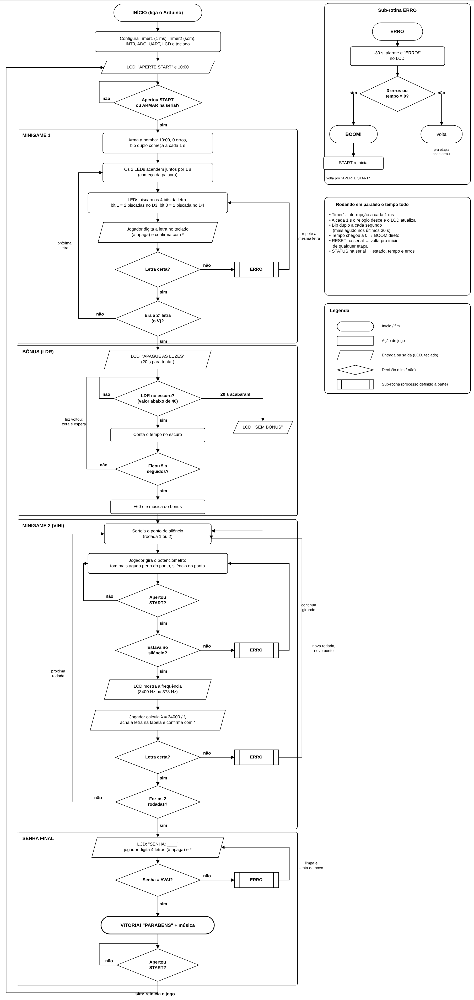

# Operação Blecaute — Escape Room no ATmega328P

Projeto final da disciplina **DAS 5332 – Arquitetura e Programação de Sistemas Microcontrolados** (UFSC, 2026.2), feito por **Pedro Linhares Mariano** e **Vinícius Pereira Linhares**.

**Código:** [jogo inteiro num arquivo só](codigo/escape_room_completo/escape_room_completo.ino) · [mesmo jogo separado por partes](codigo/escape_room)

---

## O projeto

A proposta da disciplina era criar um escape room num Arduino Uno (ATmega328P), juntando os periféricos vistos no semestre: timers, interrupções, ADC, comunicação serial, display e atuadores. Tudo é configurado direto nos registradores, sem as funções prontas do Arduino.

O nosso jogo usa:
- **dois timers:** um é o relógio da bomba e o outro gera o som do buzzer;
- **uma interrupção externa** no botão START;
- **dois canais do ADC:** o potenciômetro e o sensor de luz (LDR);
- **comunicação** UART com o computador e I2C com o LCD e o teclado;
- **LEDs e buzzer** como atuadores.

## Como foi o desenvolvimento

Começamos pela base de tudo: o relógio da bomba, com o Timer1 gerando uma interrupção a cada 1 ms, o botão START e a contagem no LCD. Depois dividimos o jogo em minigames, e cada integrante ficou com um. Os dois foram feitos e testados primeiro no simulador (Tinkercad e Wokwi).

Com os dois minigames funcionando, juntamos tudo numa máquina de estados e passamos para a placa física. Nessa etapa entraram:
- o desafio bônus com o LDR;
- os sons de erro, vitória e explosão;
- a senha final;
- os comandos pela serial.

Também tivemos que colocar o teclado num segundo barramento I2C, porque o adaptador dele vinha com o mesmo endereço do LCD.

## O jogo

O Apagão, um ex-eletricista do estádio que foi demitido, escondeu uma bomba ligada a todos os refletores. Se ela explodir, o estádio fica no escuro na noite da decisão. A bomba se desarma com uma senha de 4 letras, que ele espalhou em enigmas pela própria bomba.

A história completa está no [dossiê](docs/Historia.pdf).

## Como jogar

Antes de começar, leia o [manual](docs/Manual_do_Jogo.pdf): as tabelas para resolver os enigmas estão nele.

- Aperte **START** para armar a bomba. Vocês têm **10 minutos**.
- No teclado, **`*` confirma** e **`#` apaga**.
- Cada erro tira **30 s**. **3 erros** ou **tempo zerado** = **BOOM**.

1. **Sinais luminosos:** os LEDs piscam uma letra em binário (2 piscadas = 1, 1 piscada = 0). Os dois acesos juntos marcam o começo. Ache o código no manual e digite a letra. São 2 letras.
2. **Apague as luzes (bônus):** cubra o sensor de luz por 5 s e ganhe +60 s.
3. **O rádio:** gire o potenciômetro até o buzzer ficar em silêncio e aperte START. Com a frequência que aparece no LCD, calcule λ = 34000 / f (em cm) e ache a letra no manual. São 2 rodadas.
4. **Senha final:** digite as 4 letras na ordem e confirme com `*`.

## Fluxograma

---

## Para montar e rodar

| Pino | Componente |
| --- | --- |
| D2 | Botão START |
| D3 / D4 | LEDs |
| D5 / D6 | Teclado 3x4 |
| D11 | Buzzer |
| A0 | Potenciômetro |
| A1 | LDR (com resistor de 1 kΩ para o GND) |
| A4 / A5 | LCD 16x2 I2C |

Abra o código no Arduino IDE (placa Arduino Uno). Instale as bibliotecas **LiquidCrystal I2C** (Frank de Brabander), **SoftWire** e **AsyncDelay** (Steve Marple), que são usadas só no LCD e no I2C do teclado, e carregue na placa.

**Comandos pela serial** (9600, fim de linha "Nova linha"):

| Comando | Resposta |
| --- | --- |
| `ARMAR` | `OK ARMADA` (ou `ERRO JA ARMADA`) |
| `RESET` | `OK RESET`: reinicia o jogo |
| `STATUS` | `OK ESTADO <estado> TEMPO <s> ERROS <n>` |
| `AJUDA` | lista dos comandos |
| outro texto | `ERRO COMANDO DESCONHECIDO` |
| mais de 16 caracteres | `ERRO LINHA LONGA` |
